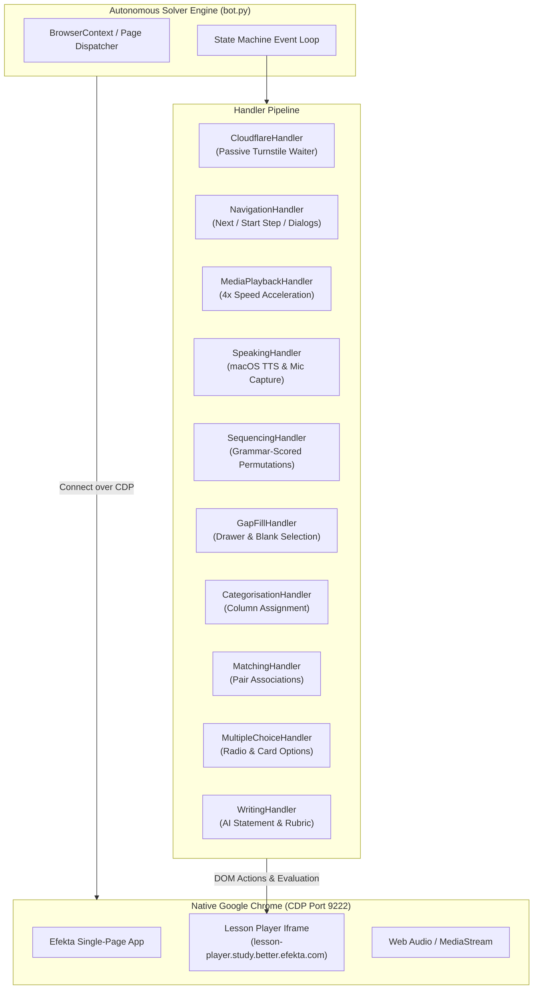

# Efekta Automation Architecture

## 1. System Overview

The **Efekta Automation Bot** is an autonomous agent designed to navigate and solve interactive curriculum units on [Efekta Self-Study](https://learn.better.efekta.com/gap/ui/self-study).

### Architectural Philosophy
1. **Zero Synthetic Cloudflare Triggers**: Rather than attempting to bypass or click Cloudflare Turnstile CAPTCHA checkboxes via automated drivers (which triggers bot detection telemetry), the bot connects to a **real, native Google Chrome instance** over the Chrome DevTools Protocol (`CDP`).
2. **Modular Handler Strategy**: Each interaction type in Efekta (Media, Speaking, Sequencing, Gap Fill, Categorisation, Matching, Multiple Choice, Writing, Navigation) is isolated into a dedicated handler class that implements `BaseHandler`.
3. **Decoupled Verification**: Every exercise handler maintains internal retry and circuit-breaker state to prevent infinite loops, capping attempts and gracefully advancing.

---

## 2. Component Architecture

---

## 3. Handler Execution Priority Pipeline

In each loop cycle, the solver scans the active view (and nested `lesson-player` iframes) and evaluates handlers in strict order of priority:

| Priority | Handler | Trigger Condition | Primary Action |
|:---:|---|---|---|
| **1** | `CloudflareHandler` | Cloudflare Turnstile challenge visible | Waits passively for natural session validation. **Never clicks synthetic checkboxes.** |
| **2** | `NavigationHandler` | Active Dialogs, `Next`, `Start next step`, `Check` | Prioritizes forward progress (`Next` / `Start next step`) over repeating skipped tasks. |
| **3** | `MediaPlaybackHandler` | Video / Audio player present, `Next` disabled | Accelerates `playbackRate = 4.0`, plays to completion or interactive prompt. |
| **4** | `SpeakingHandler` | `ef-audio-recorder` button or speech task active | Speaks target phrase aloud via macOS `say` TTS, triggers recording, enforces retry caps. |
| **5** | `SequencingHandler` | `ef-sequencing-tap-option-task` or CDK drag | Bigram grammar scoring evaluates candidate permutations; keyboard reorders CDK drag lists. |
| **6** | `GapFillHandler` | `.selection-gap-button` or drawer options open | Clicks unfilled blanks and systematically rotates drawer options. |
| **7** | `CategorisationHandler` | Category columns & unassigned cards present | Distributes items to category drop-zones. |
| **8** | `MatchingHandler` | Matchable source/target pairs visible | Connects left/right or top/bottom associated pairs. |
| **9** | `MultipleChoiceHandler` | Radio options, choice cards, option items | Iterates untried answer options and submits answer. |
| **10** | `WritingHandler` | Freeform writing textarea & word count goals | Composes compliant response and completes 5-star rubric evaluation. |

---

## 4. Key Subsystems & Design Choices

### 4.1 Native Chrome via CDP
Automated browser automation frameworks (Playwright, Puppeteer, Selenium) set navigator flags (e.g. `navigator.webdriver = true`) and distinct TLS/HTTP2 fingerprints. By starting a native Google Chrome process (`/Applications/Google Chrome.app/Contents/MacOS/Google Chrome --remote-debugging-port=9222`) and connecting via Patchright CDP, Cloudflare Turnstile evaluates the browser as an authentic user workstation.

### 4.2 Speech Recognition & TTS Integration
Efekta evaluates speech tasks using browser-level speech recognition and MediaStream audio.
- The bot extracts target text from DOM prompts or lesson metadata.
- When recording begins, `SpeakingHandler` uses native macOS speech synthesis (`say -v Samantha "<target_phrase>"`) through the system speakers, which is captured by the microphone input.
- To prevent getting stuck if ambient background noise interferes, tasks are capped at 1-2 attempts before advancing via `SKIP`, while `NavigationHandler` ensures forward continuity.

### 4.3 Grammar-Scored Permutation Heuristics
Sentence reconstruction exercises require ordering scrambled words. Instead of $N!$ factorial blind brute force:
1. Capitalized words are pinned to the start.
2. Punctuation-terminated tokens (`.`, `?`, `!`) are pinned to the end.
3. Middle permutations are scored against an English grammar bigram matrix (subject pronouns $\to$ verbs $\to$ infinitive markers $\to$ prepositional phrases).
4. Failed permutations are recorded in an in-memory set to prevent redundant checks.
